# 🚛 Rétro MirrorCast

**Deux vieilles tablettes Android deviennent les rétroviseurs du camion dans Euro Truck Simulator 2.**

Fixées de chaque côté de l'écran, elles montrent en direct le rétro gauche et le rétro droit du jeu, envoyés par le
logiciel **MirrorCast** du PC. Le décor de la tablette prend le thème choisi sur le tableau de bord. Clignotants, angle
mort et pluie sont dessinés directement dans l'image.

  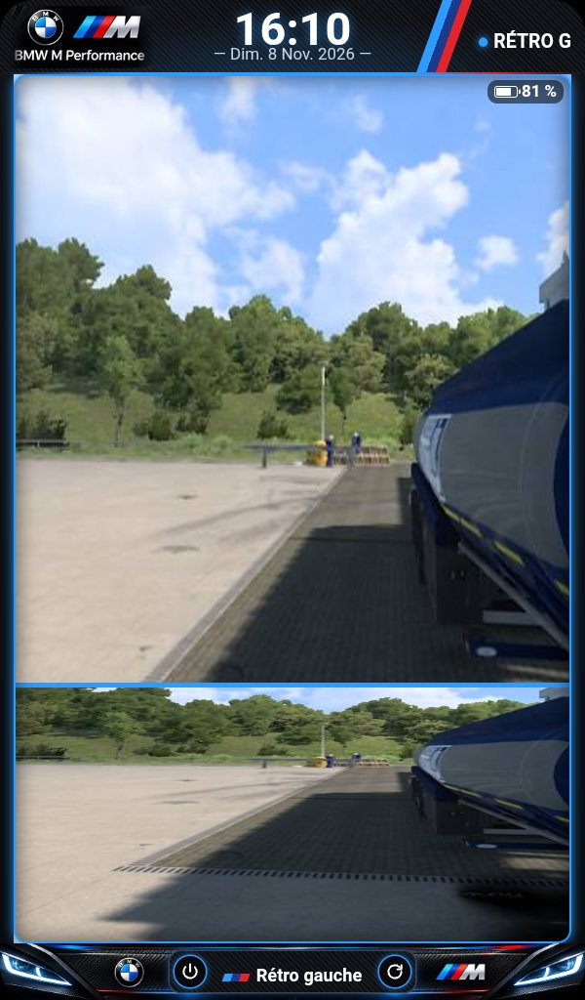
  &nbsp;&nbsp;
  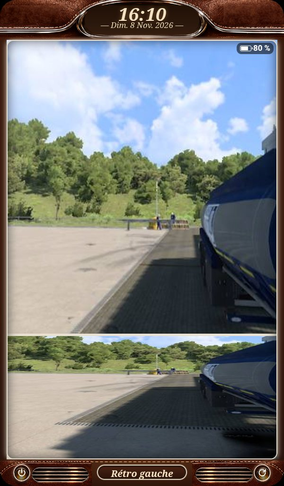

---

## ✨ Ce que fait l'appli

| | |
|---|---|
| 🪞 **Rétro en direct** | Image du jeu à 30 images/s, plein écran, sans bandes noires. Moins de 1 % d'images perdues en roulant. |
| 🔭 **Grand-angle** | Le bas de l'écran montre la zone proche du camion, comme un vrai rétro d'accostage. |
| 🎨 **13 thèmes** | Le décor suit le thème du tableau de bord et change en 1 seconde. |
| ↪️ **Clignotant** | Une flèche orange clignote sur le rétro du bon côté, en même temps que le clignotant (ou les warnings). |
| ⚠️ **Angle mort** | Un triangle rouge clignote avec le clignotant de ce côté. |
| 🌧️ **Pluie** | Gouttes et traînées sur la vitre, selon la vitesse des essuie-glaces. |
| 🌙 **Nuit** | Écran baissé à 25 % la nuit dans le jeu (21 h – 6 h). |
| 🕒 **Veille** | Jeu fermé : l'heure en grand, écran au minimum. |
| 🔋 **Batterie** | Pourcentage en haut à droite. Vert avec un éclair en charge, rouge sous 20 %. |
| ⏻ **Éteindre / Redémarrer** | Deux boutons ronds sur chaque thème. On touche deux fois pour confirmer. |
| 🏠 **Toujours prête** | La tablette démarre directement sur le rétro, sans rien toucher. |

---

## 📸 En action

<table>
  <tr>
    <td align="center" width="33%">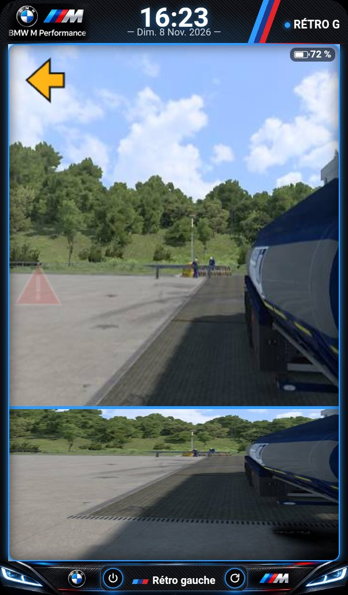 <b>Clignotant + angle mort</b> Flèche orange et triangle rouge, au rythme du clignotant</td>
    <td align="center" width="33%">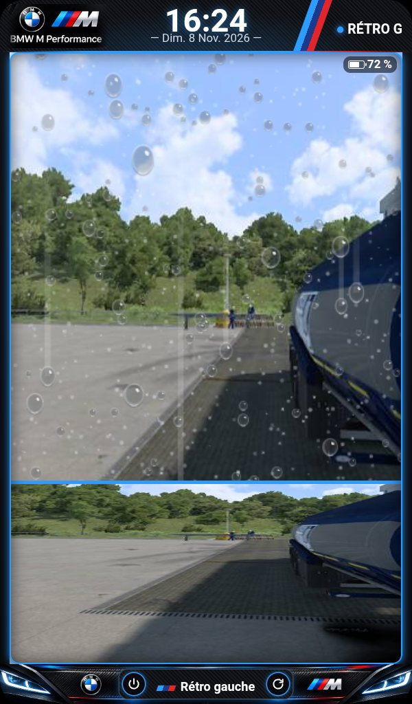 <b>Pluie</b> Gouttes et traînées selon les essuie-glaces</td>
    <td align="center" width="33%">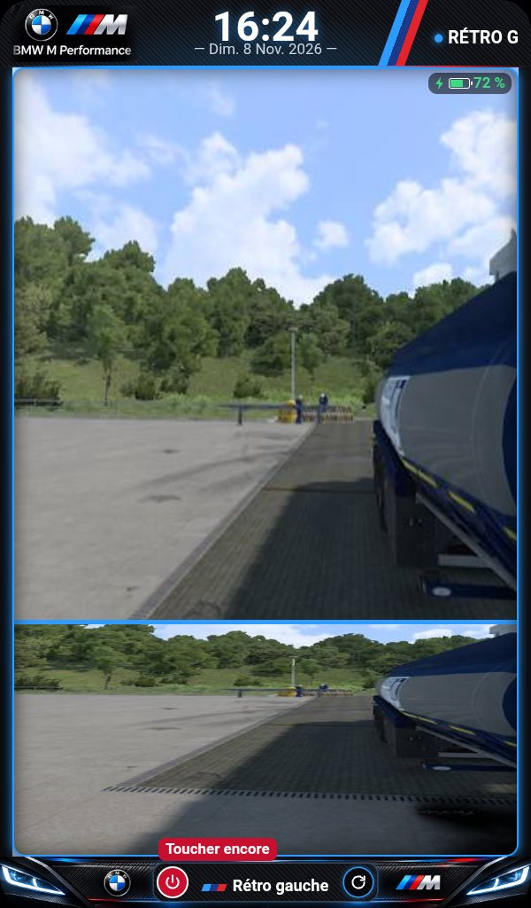 <b>Éteindre + batterie</b> 1re touche : « Toucher encore » ; éclair vert en charge</td>
  </tr>
  <tr>
    <td align="center">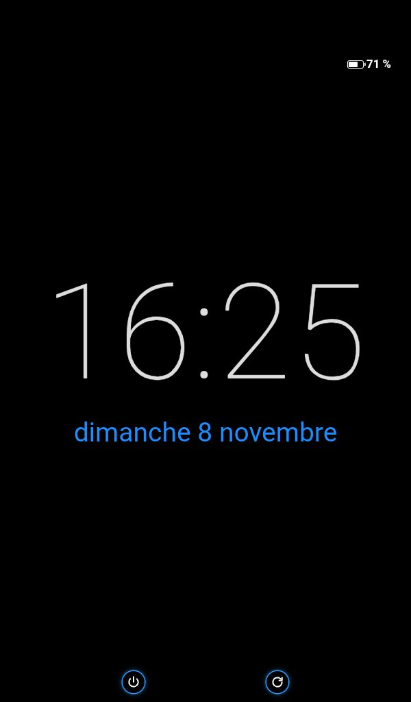 <b>Veille</b> Jeu fermé : l'heure en grand, écran au minimum</td>
    <td align="center">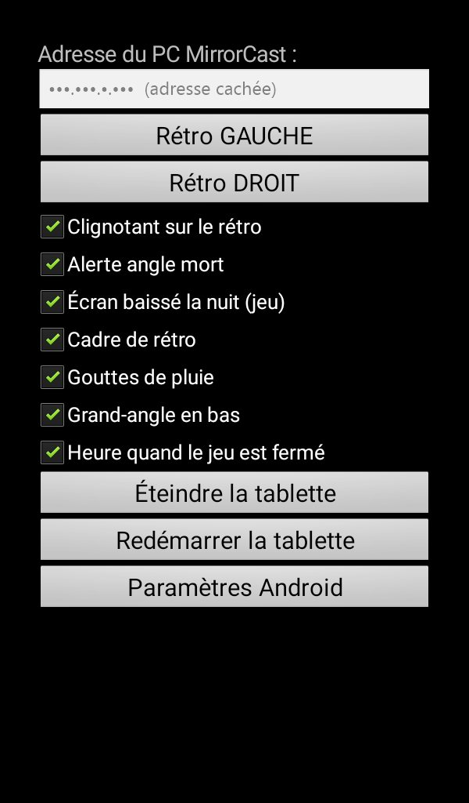 <b>Réglages</b> Bouton Retour : côté du rétro, options à cocher</td>
    <td align="center" valign="middle"><b>🔭 Grand-angle</b>  Sur toutes les photos : le bas de l'écran montre la zone proche du camion.</td>
  </tr>
</table>

---

## 🎨 Les thèmes

<table>
  <tr>
    <td align="center"> <b>BMW M</b></td>
    <td align="center">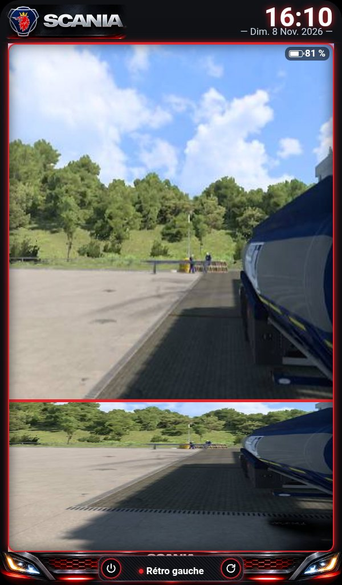 <b>Scania</b></td>
    <td align="center">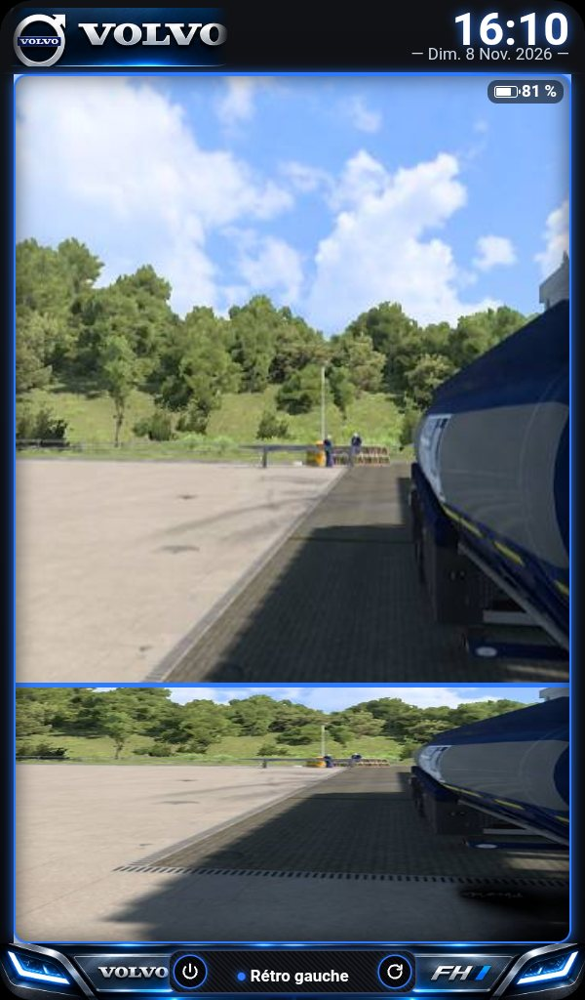 <b>Volvo FH</b></td>
    <td align="center">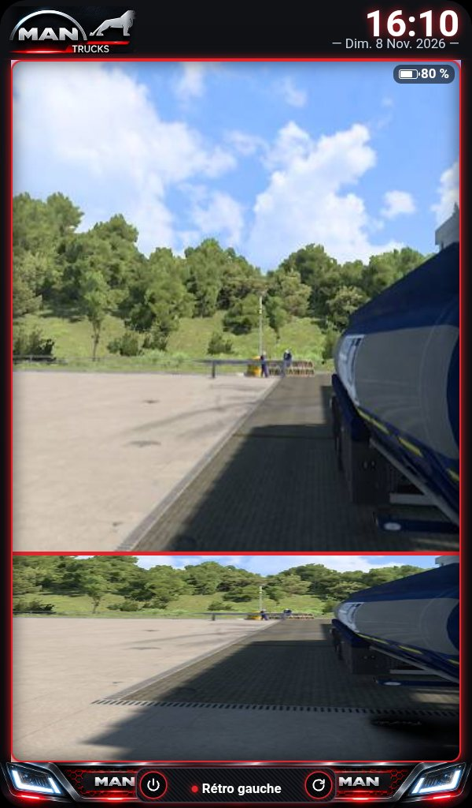 <b>MAN</b></td>
  </tr>
  <tr>
    <td align="center">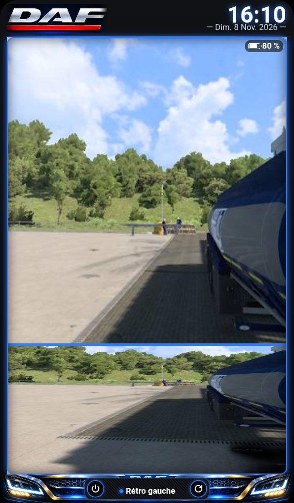 <b>DAF XF</b></td>
    <td align="center">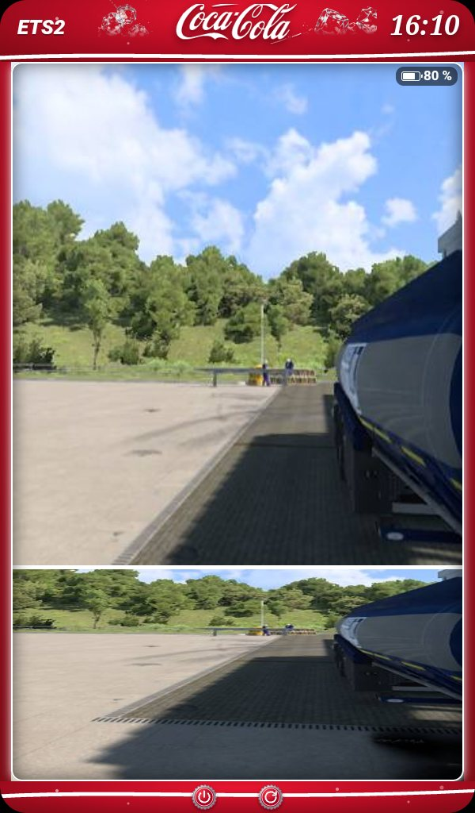 <b>Cola</b></td>
    <td align="center">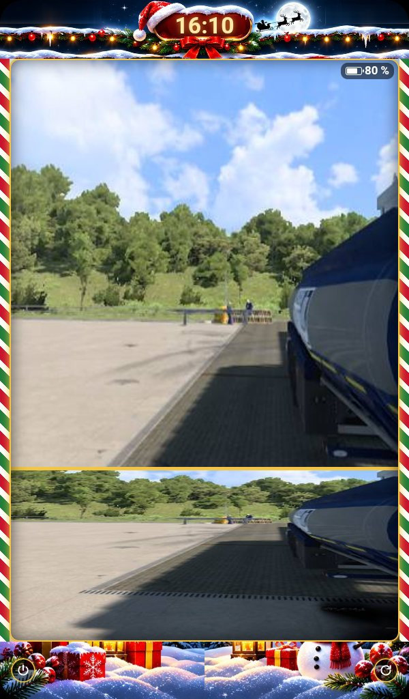 <b>Noël</b></td>
    <td align="center"> <b>Vieil autoradio</b></td>
  </tr>
  <tr>
    <td align="center">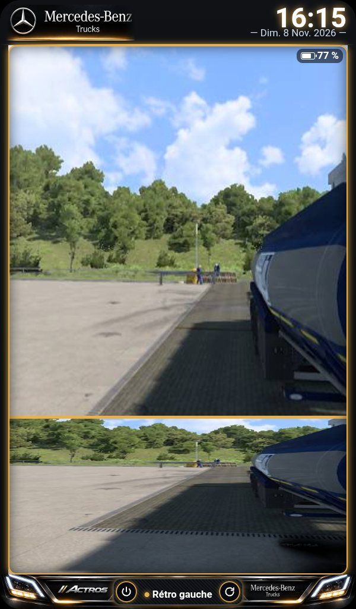 <b>Mercedes-Benz</b></td>
    <td align="center">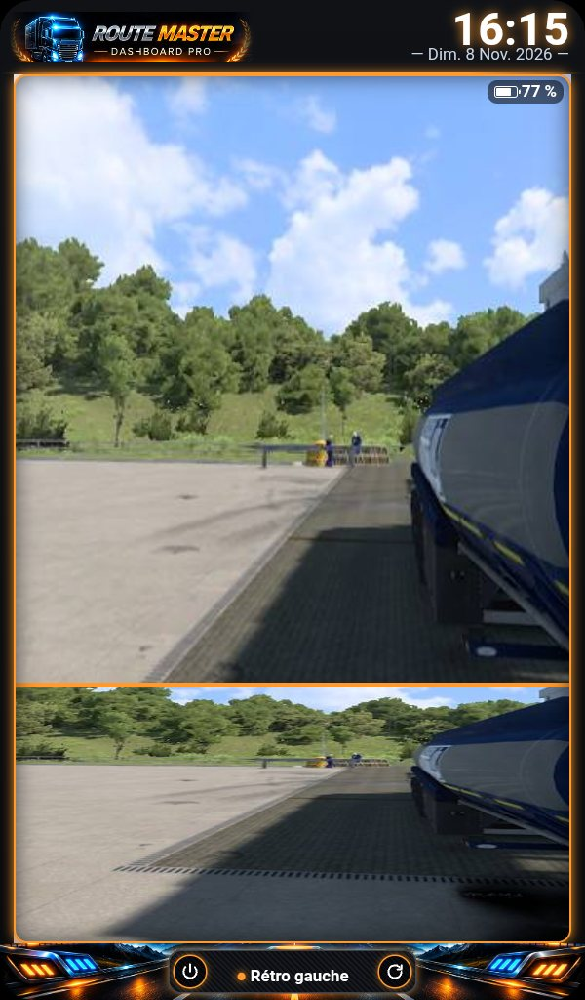 <b>Route Master</b></td>
    <td align="center">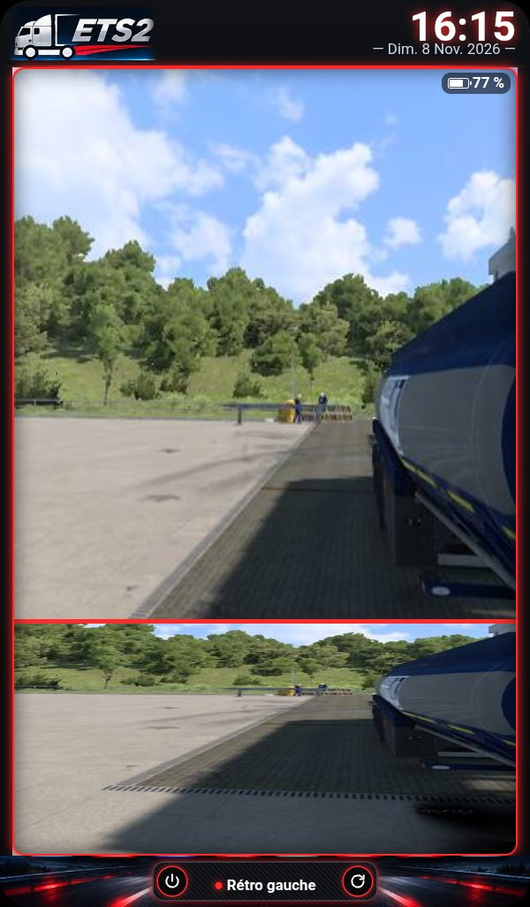 <b>Android</b></td>
    <td align="center">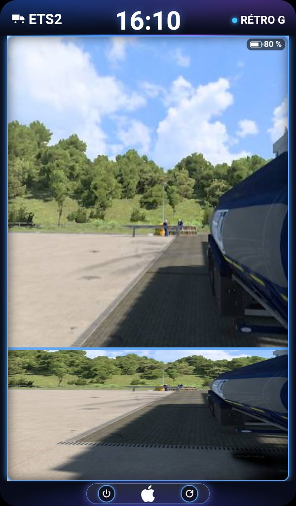 <b>iOS</b></td>
  </tr>
  <tr>
    <td align="center">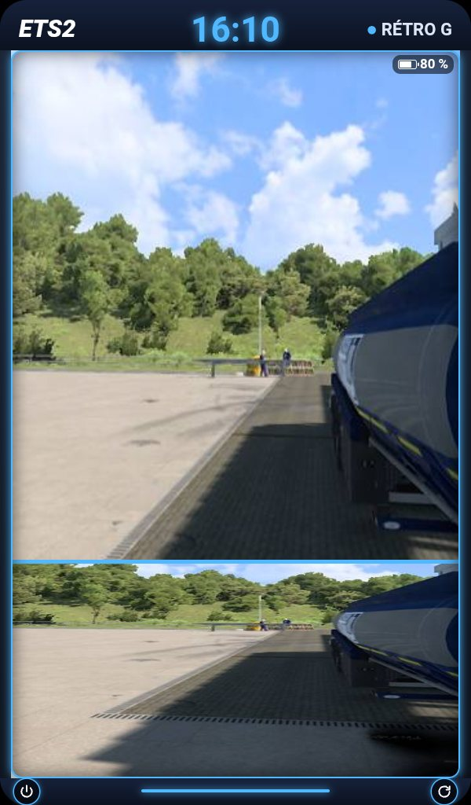 <b>Normal</b></td>
    <td colspan="3" valign="middle">
      Le thème se choisit sur le tableau de bord MirrorCast. Les deux rétros suivent tout seuls, en 1 seconde.
    </td>
  </tr>
</table>

*Photos prises sur le vrai rétro gauche, jeu lancé, le 8 novembre 2026.*

---

## 🧰 Matériel

- 2 tablettes **incar K708** (Android 11 Go, 600 × 1024), en Wi-Fi.
- Un PC avec **ETS2** et **MirrorCast**, sur le même réseau.

---

*Vitrine du projet : le code source n'est pas public.*
